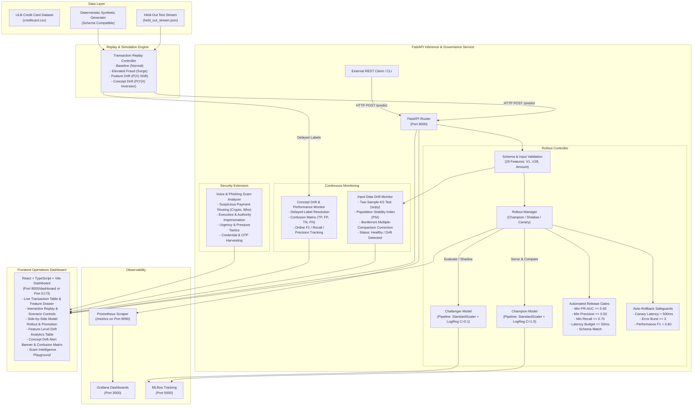

# TrustOps: Automated MLOps Framework for Fraud Detection
TrustOps is a fraud detection and model reliability platform designed to identify potentially fraudulent credit-card transactions and monitor how detection models behave as transaction patterns change. Beyond making individual predictions, it provides a structured approach to evaluating competing models, identifying suspicious changes in incoming data, monitoring prediction quality, and reducing the risks associated with model updates.

The project demonstrates an end-to-end fraud detection lifecycle, from model training and evaluation to deployment, monitoring, and controlled model releases. It also includes simulated transaction scenarios and a cybersecurity scam analysis extension to explore related security threats.

### Key Features:
- **Fraud Detection**: Binary classification of legitimate and potentially fraudulent transactions using the credit-card fraud dataset.
- **Benchmark ML Dataset**: Standard European ULB credit-card fraud dataset (imbalanced classification: 0.172% fraud).
- **Model Governance**: Imbalance-aware pipelines, validation-tuned threshold selection, and MLflow experiment tracking.
- **Champion / Challenger**: Controlled model evaluation, automated release gates, and safe promotion.
- **Inference & Rollout Service**: FastAPI supporting Champion-Only, Shadow Mode (dual scoring) and Canary Rollouts.
- **Automated Rollback**: Safeguard triggers on latency spikes, error bursts, and delayed-label performance drops.
- **Two-Factor Drift Monitoring**: Two-Sample Kolmogorov–Smirnov test (`ks_2samp`) with Population Stability Index (PSI) with Bonferroni multiple comparison correction.
- **Concept Drift & Delayed Labels**: Delayed ground-truth label ingestion, online confusion matrix, and performance deterioration alerts.
- **Live Transaction Replay**: Multi-scenario background replay engine (Baseline, Elevated Fraud Attack, Feature Drift, Concept Drift).
- **Cybersecurity Scam Extension**: NLP heuristic & threat pattern detector for voice transcripts and phishing emails.
- **Operations Dashboard**: Modern React + TypeScript + Vite operations UI.
- **Prometheus & Grafana**: Production observability metrics and pre-provisioned Grafana dashboards.
- **Git & GitHub Actions**: Version Control and CI workflow support.

> [!NOTE]
> **Operational Caveat:** This platform operates on historical anonymized benchmark data (PCA features `V1`–`V28` + `Amount`). Model predictions represent calibrated statistical risk estimates, not definitive legal proof of fraud. Production use would require further validation, security controls, operational testing, and compliance review.

---

## 1. System Architecture



---

## 2. Repository Layout

```text
TrustOps/
├── app/
│   ├── api/
│   │   ├── main.py              # FastAPI application, routes, lifespan & static dashboard mount
│   │   ├── monitoring.py        # KS-test & PSI drift monitor + delayed performance tracker
│   │   ├── replay.py            # Background replay engine & bounded transaction store
│   │   ├── rollout.py           # Rollout manager, release gates & auto-rollback engine
│   │   └── schemas.py           # Pydantic request/response schemas & model contracts
│   ├── core/
│   │   └── config.py            # Centralized application & threshold configuration
│   ├── ml/
│   │   ├── data.py              # Dataset loading, column verification & stratified split
│   │   ├── metrics.py           # F1 threshold tuning & evaluation metrics (PR-AUC, ROC-AUC)
│   │   └── train.py             # Model training, MLflow logging, reference sample generation
│   └── scam/
│       ├── __init__.py
│       └── detector.py          # Voice transcript & phishing email threat analyzer
├── data/
│   ├── raw/
│   │   └── creditcard.csv       # Canonical ULB dataset
│   └── processed/
│       └── held_out_stream.json # Extracted held-out test split for realistic replay (2,574 records)
├── frontend/
│   ├── src/
│   │   ├── App.tsx              # Operations dashboard UI with full tabbed controls
│   │   ├── api.ts               # Typed client calling FastAPI endpoints
│   │   ├── types.ts             # TypeScript definitions matching backend schemas
│   │   ├── index.css            # Dark cybersecurity theme styling
│   │   └── main.tsx             # Vite entrypoint
│   ├── index.html
│   ├── package.json
│   ├── tsconfig.json
│   └── vite.config.ts           # Proxy to FastAPI port 8000
├── models/
│   ├── champion.joblib          # Active champion pipeline artifact
│   ├── challenger.joblib        # Challenger candidate pipeline artifact
│   ├── metadata.json            # Model lineage, validation metrics & feature schema
│   └── reference.json           # Fixed training baseline distributions (quantiles + samples)
├── monitoring/
│   ├── prometheus.yml           # Prometheus scrape configuration
│   └── grafana/
│       ├── dashboards/
│       │   └── trustops.json    # Pre-provisioned Grafana dashboard (10 metric panels)
│       └── provisioning/
│           ├── dashboards/dashboard.yml
│           └── datasources/datasource.yml
├── scripts/
│   ├── download_data.py         # OpenML dataset mirror downloader
│   └── stream_transactions.py   # CLI transaction streaming & scenario injection tool
├── tests/
│   ├── test_api.py              # Root & health route contract tests
│   ├── test_api_integration.py  # Full FastAPI integration tests across all endpoints
│   ├── test_delayed_labels.py   # Delayed label matching, confusion matrix & concept drift
│   ├── test_drift.py            # Two-sample KS test, PSI, Bonferroni & window reset tests
│   ├── test_metrics.py          # Threshold optimization & classification metrics
│   ├── test_replay.py           # Replay engine scenarios & transaction store CRUD
│   ├── test_rollout.py          # Shadow/canary, latency rollback, release gates & promotion
│   ├── test_scam.py             # Phishing & voice social engineering tests
│   └── test_training_smoke.py   # Deterministic CI training smoke test
├── .env.example                 # Environment variable templates
├── docker-compose.yml           # Complete containerized stack configuration
├── Dockerfile                   # Multi-stage Python + pre-built frontend container
├── pytest.ini                   # Pytest configuration (filters .venv and optimizes runs)
├── requirements.txt             # Pinned Python dependencies
└── README.md                    # Complete technical documentation
```

---

## 3. Local Setup (Windows 11 PowerShell)

### Prerequisites
- **Python 3.11 or 3.12** (`py --version`)
- **Node.js 18+ & npm** (`node --version`)
- **Docker Desktop** (optional for local container orchestration)


### Step 1: Create a Virtual Environment and Install Dependencies

Open Windows PowerShell and navigate to the project directory:

```powershell
cd D:\projects\TrustOps\TrustOps

# Create a Python virtual environment
py -3.11 -m venv .venv

# Activate the environment
.\.venv\Scripts\Activate.ps1

# If script execution is restricted, run this first:
# Set-ExecutionPolicy -Scope Process -ExecutionPolicy Bypass

# Upgrade pip and install dependencies
python -m pip install --upgrade pip
pip install -r requirements.txt
```

### Step 2: Configure Environment Variables

Create a local `.env` file from the example configuration:

```powershell
Copy-Item .env.example .env
```

Open `.env` and review the configuration values. The available variables and their defaults are defined in `.env.example`.

Important configuration settings include:

| Variable | Purpose |
|---|---|
| `MODEL_DIR` | Directory containing trained model artifacts |
| `DATA_PATH` | Path to the raw credit-card fraud dataset |
| `HELD_OUT_STREAM_PATH` | Path to the held-out transaction stream |
| `MLFLOW_TRACKING_URI` | MLflow tracking server or local tracking directory |
| `ROLLOUT_MODE` | Initial model rollout mode |
| `CANARY_PERCENT` | Percentage of traffic allocated to the challenger |
| `CANARY_MAX_LATENCY_MS` | Maximum permitted challenger prediction latency |
| `CANARY_LATENCY_FAILURES` | Latency failures required to trigger rollback |
| `CANARY_ERROR_FAILURES` | Prediction errors required to trigger rollback |
| `DRIFT_WINDOW_SIZE` | Number of recent transactions used for drift monitoring |
| `DRIFT_MIN_SAMPLES` | Minimum samples required before evaluating drift |
| `DRIFT_KS_ALPHA` | Significance level for the Kolmogorov-Smirnov test |
| `DRIFT_PSI_THRESHOLD` | Population Stability Index threshold |
| `DRIFT_EFFECT_SIZE_THRESHOLD` | Effect-size threshold for drift monitoring |
| `PERFORMANCE_WINDOW_SIZE` | Window used for delayed-label performance monitoring |
| `PERFORMANCE_F1_ALERT_THRESHOLD` | F1-score threshold for performance alerts |
| `GRAFANA_PASSWORD` | Grafana administrator password for Docker deployment |

Use the exact variable names and defaults provided in `.env.example`. Keep `.env` local and never commit credentials or secrets to GitHub.

**Note:** Docker Compose reads `.env` automatically. For local Python execution, export any required variables into the PowerShell session because the application does not automatically load `.env`.

For example:

```powershell
$env:MODEL_DIR = "models"
$env:DATA_PATH = "data/raw/creditcard.csv"
$env:MLFLOW_TRACKING_URI = "file:./mlruns"
```

These environment variables apply to the current PowerShell session.

### Step 3: Download and Prepare the Dataset

Download the credit-card fraud detection dataset:

```powershell
python scripts/download_data.py
```

The dataset is expected at:

```text
data/raw/creditcard.csv
```

Verify that the file exists:

```powershell
Test-Path data/raw/creditcard.csv
```

The command should return `True`.

If the automatic download fails, download the dataset from [Kaggle: Credit Card Fraud Detection](https://www.kaggle.com/datasets/mlg-ulb/creditcardfraud) and place `creditcard.csv` in `data/raw/`.

The dataset contains anonymized transaction features (`V1`–`V28`), the transaction amount, and the binary `Class` target. The canonical dataset also includes `Time`; the training pipeline supports compatible versions that omit it.

During training, the pipeline validates the input data, creates stratified training, validation, and test splits, and generates reference distributions for subsequent drift monitoring.

### Step 4: Train the Champion and Challenger Models

Once the dataset is available, execute the training pipeline:

```powershell
python -m app.ml.train
```

The pipeline:

1. Loads and validates the dataset.
2. Creates stratified training, validation, and test splits.
3. Trains two class-weighted Logistic Regression candidates with different regularization settings.
4. Selects a classification threshold using validation data.
5. Selects the champion based on validation average precision.
6. Evaluates the models on held-out test data.
7. Logs experiment parameters, metrics, and models to MLflow.
8. Saves the trained model artifacts and reference distributions.

After successful training, the following files should be available:

```text
models/
├── champion.joblib
├── challenger.joblib
├── metadata.json
└── reference.json
```

| Artifact | Purpose |
|---|---|
| `champion.joblib` | Model selected as the champion |
| `challenger.joblib` | Alternative model used for comparison and rollout demonstrations |
| `metadata.json` | Feature schema, thresholds, model lineage, and evaluation metrics |
| `reference.json` | Training-data reference distributions for drift monitoring |

The default MLflow tracking location is `file:./mlruns` when `MLFLOW_TRACKING_URI` is not configured. To log experiments to the MLflow server running through Docker Compose, start that service and set the tracking URI to `http://localhost:5000` before training locally.

**Note:** Training generates model and reference artifacts. It does not automatically create `data/processed/held_out_stream.json`. Ensure the held-out replay stream is available separately if your replay workflow requires it.

### Step 5: Build the Frontend Dashboard

Build the frontend so the compiled dashboard can be served by FastAPI:

```powershell
cd frontend
npm.cmd ci
npm.cmd run build
cd ..
```

The compiled files are generated in `frontend/dist/` and served at:

[http://localhost:8000/dashboard/](http://localhost:8000/dashboard/)

### Step 6: Run the Automated Test Suite

Run the tests after configuring the environment and generating the required artifacts:

```powershell
python -m pytest
```

Review the test summary to confirm the actual number of tests and whether they passed. The suite covers areas such as preprocessing, evaluation metrics, drift detection, model rollouts, rollback safeguards, delayed-label monitoring, scam analysis, and API behaviour.

### Step 7: Start the API Service

Start the FastAPI application:

```powershell
python -m uvicorn app.api.main:app --host 127.0.0.1 --port 8000 --reload
```

Ensure the required model artifacts exist before starting the API.

Once the service is running, access the following endpoints:

| Service | URL |
|---|---|
| Operations dashboard | [http://localhost:8000/dashboard/](http://localhost:8000/dashboard/) |
| Interactive API documentation | [http://localhost:8000/docs](http://localhost:8000/docs) |
| Health check | [http://localhost:8000/health](http://localhost:8000/health) |
| Prometheus metrics | [http://localhost:8000/metrics](http://localhost:8000/metrics) |

### Alternative: Run the Complete Stack Using Docker Compose

After downloading the dataset and generating the model artifacts, build and start the containers:

```powershell
docker compose build
docker compose up -d
docker compose ps
```

To run the training pipeline inside Docker, use the configured training profile:

```powershell
docker compose --profile train run --rm trainer
```

The training service expects the dataset under `data/raw/` and writes model artifacts under `models/`. Ensure the MLflow service is healthy before starting containerized training.

The full stack exposes the following services:

| Service | URL |
|---|---|
| FastAPI and dashboard | [http://localhost:8000](http://localhost:8000) |
| MLflow | [http://localhost:5000](http://localhost:5000) |
| Prometheus | [http://localhost:9090](http://localhost:9090) |
| Grafana | [http://localhost:3000](http://localhost:3000) |

Stop the containers with:

```powershell
docker compose down
```


## 4. Local URLs & Service Endpoints

| Service | Local URL | Description |
|---|---|---|
| **Frontend Operations Dashboard** | [http://localhost:8000/dashboard/](http://localhost:8000/dashboard/) | Complete UI: Live table, streaming controls, drift, rollout & scam analyzer |
| **FastAPI Swagger Docs** | [http://localhost:8000/docs](http://localhost:8000/docs) | Interactive OpenAPI documentation for all endpoints |
| **Health Check** | [http://localhost:8000/health](http://localhost:8000/health) | API status, models loaded, uptime, rollout mode |
| **Prometheus Metrics** | [http://localhost:8000/metrics](http://localhost:8000/metrics) | Real Prometheus metrics exporter |
| **Grafana Dashboard** *(Docker)* | [http://localhost:3000](http://localhost:3000) | Observability dashboards (`admin` / `admin`) |
| **MLflow Tracking UI** *(Docker)* | [http://localhost:5000](http://localhost:5000) | Model runs, parameters, metrics, and logged artifacts |
| **Prometheus Server** *(Docker)* | [http://localhost:9090](http://localhost:9090) | Time-series metrics engine |
| **Frontend Dev Server** *(Optional)* | [http://localhost:5173](http://localhost:5173) | Vite hot-reloading dev server (`cd frontend; npm run dev`) |

---

## 5. Live Demonstration & Verification Walkthrough

You can execute all scenarios directly through the web UI at `http://localhost:8000/dashboard/` or via CLI / PowerShell:

### Scenario A: Baseline Transaction Streaming
1. Open `http://localhost:8000/dashboard/` and navigate to the **Replay Controls** tab.
2. Select **1. Baseline Traffic**, adjust speed to **5 tx/sec**, and click **Start Replay Stream**.
3. Switch to the **Live Transactions** tab to view transactions streaming in real time with calculated fraud probabilities, decision badges (`allow` or `review`), model versions, and latency.
4. Click **View** on any transaction to inspect all 29 input features and raw output schemas in the detail modal.
5. Alternatively, run via PowerShell:
   ```powershell
   python scripts/stream_transactions.py --scenario baseline --speed 5 --count 50
   ```

### Scenario B: Inject Feature Data Drift
1. In the **Replay Controls** tab, select **3. Feature Data Drift** and click **Start Replay Stream** (or use the CLI):
   ```powershell
   python scripts/stream_transactions.py --scenario feature_drift --speed 10 --count 60
   ```
2. Navigate to the **Data Drift Monitor** tab.
3. Observe the drift status switch to **DRIFT DETECTED** (red alert badge).
4. Review the feature-level statistical table: features such as `V1`, `V2`, `V3`, `V4`, and `Amount` will flag as `DRIFTED` with statistically significant p-values ($< 0.0017$ Bonferroni threshold), elevated KS statistics, and high PSI values.
5. Click **Reset Window** to clear the monitoring window back to baseline.

### Scenario C: Demonstrate Concept Drift & Delayed Labels
1. In the **Replay Controls** tab, select **4. Concept Drift** and click **Start Replay Stream** (or run via CLI):
   ```powershell
   python scripts/stream_transactions.py --scenario concept_drift --speed 10 --count 40
   ```
2. In this scenario, fraud events are disguised as low-amount normal transactions with inverted flags, causing the model to allow them.
3. Switch to the **Concept Drift & Delayed Labels** tab.
4. As delayed ground-truth labels arrive (simulating confirmed fraud reports or chargebacks), watch the confusion matrix update with a surge in **False Negatives (FN)**.
5. When the online F1 score drops below 60% or recall falls, an alert triggers:
   `"Concept drift / performance deterioration: Delayed F1 score is below threshold."`

### Scenario D: Test Shadow & Canary Rollouts
1. Navigate to the **Rollout & Release Gates** tab.
2. **Shadow Mode**: Click **2. Shadow Mode**. Every prediction scores both the Champion and Challenger models. The Champion decision is served while Challenger probabilities are logged.
3. **Canary Mode**: Click **3. Canary Rollout** and set the traffic allocation slider to **25%**. 25% of incoming traffic is routed to the Challenger model.
4. To configure via PowerShell:
   ```powershell
   Invoke-RestMethod -Method Post -Uri http://127.0.0.1:8000/models/rollout-mode -ContentType "application/json" -Body '{"mode": "canary", "canary_percent": 30}'
   ```

### Scenario E: Trigger Automated Canary Rollback
1. TrustOps includes automated safeguards: if the candidate experiences slow predictions ($> 500\text{ ms}$) or repeated errors, traffic is instantly rolled back to the Champion.
2. Trigger an immediate emergency rollback from the UI by clicking **Emergency Rollback**, or via PowerShell:
   ```powershell
   Invoke-RestMethod -Method Post -Uri http://127.0.0.1:8000/models/rollback -ContentType "application/json" -Body '{"reason": "Latency spike observed in upstream microservice"}'
   ```
3. Observe the `ROLLED BACK` alert banner and Prometheus metric `trustops_canary_rollbacks_total` incrementing.

### Scenario F: Release Gates & Model Promotion
1. In the **Rollout & Release Gates** tab, review the automated release gates checklist:
   - **Schema Compatibility**: Verifies exact match of all 29 features.
   - **Min PR-AUC**: Target $\ge 0.65$.
   - **Min Precision**: Target $\ge 0.50$.
   - **Min Recall**: Target $\ge 0.70$.
   - **Latency Budget**: Target $\le 50\text{ ms}$.
2. Click **Promote Challenger to Champion**. If all gates pass, the models and thresholds are swapped safely, recorded in the audit log, and logged to Prometheus.

### Scenario G: Phishing & Voice Scam Analysis
1. Navigate to the **Scam Analyzer** tab.
2. Click **CEO Wire Fraud** or **Fake IT Support (Audio Call)** to load sample attack transcripts.
3. Click **Analyze Communication for Threats**.
4. Review the extracted signals:
   - Threat level (`CRITICAL SCAM` or `SUSPICIOUS`)
   - Risk score ($0 - 100$)
   - Extracted evidence categories: Suspicious payment instructions, authority impersonation, urgency/pressure tactics, and credential requests.
5. Test the **Legitimate Invoice** sample to verify low risk ($< 35/100$) and clean classification.

---

## 6. Troubleshooting

| Symptom | Cause | Solution |
|---|---|---|
| `Model artifacts not found in models` | Models have not been trained or extracted | Run `python -m app.ml.train` to generate `champion.joblib`, `challenger.joblib`, `reference.json`, and `metadata.json`. |
| Drift endpoint shows `status: "collecting"` | Monitoring window has not reached minimum sample count | The monitor requires at least 50 samples before running statistical tests. Start the replay stream or run `python scripts/stream_transactions.py --count 55`. |
| Port 8000 or 3000 already in use | Another service is using the port | Check running processes with `netstat -ano \| findstr :8000` and stop conflicting services, or configure another port in `.env`. |
| PowerShell script activation disabled | Windows execution policy restriction | Run `Set-ExecutionPolicy -Scope Process -ExecutionPolicy Bypass`, then activate `.\.venv\Scripts\Activate.ps1`. |
| npm execution policy blocked in PowerShell | Running `.ps1` wrapper blocked | Use `npm.cmd` instead of `npm`, e.g., `npm.cmd run build`. |


## 7. Security and Limitations

- The benchmark dataset is historical and anonymized. It does not represent every contemporary fraud pattern.
- The V1–V28 features are transformed features rather than interpretable raw transaction attributes.
- Synthetic replay scenarios demonstrate monitoring behavior under controlled conditions; they are not substitutes for real-world validation.
- Statistical feature drift does not automatically prove concept drift or degraded model quality.
- Delayed-label evaluation depends on the correctness and availability of ground-truth labels.
- Scam-analysis rules can generate false positives and false negatives.
- Release thresholds must be justified by evaluation results and business requirements.
- Model promotion and rollback must be tested against failure cases before being trusted operationally.
- Development credentials and secrets must not be committed to source control.
- Production deployment would require additional authentication, authorization, network restrictions, secret management, audit controls, privacy safeguards, and operational validation.

## 8. Future Improvements

- Validate the framework against additional datasets and more realistic transaction distributions.
- Introduce stronger authentication and authorization for operational controls.
- Add model-artifact integrity checks and a more formal approval process.
- Improve the handling of delayed and partially verified labels.
- Expand monitoring to cover model quality, data quality, and service reliability together.
- Add reproducible deployment environments and integration tests.
- Evaluate the scam analyzer against a labeled communication dataset.
- Establish production deployment policies, incident procedures, and audit trails.

## 9. Project Summary

TrustOps demonstrates how fraud detection can be treated as a complete, continuously evaluated system rather than a standalone machine learning model. It brings together model evaluation, controlled model updates, drift monitoring, delayed-label performance tracking, operational observability, and cybersecurity scam analysis in one project.

The central objective is to make model behavior easier to evaluate, changes safer to manage, and potential performance problems easier to identify.

---
**Project**: TrustOps: Automated MLOps Framework for Fraud Detection
**Purpose**: Fraud detection, model lifecycle management and monitoring demonstration
**Dataset**: European credit-card fraud benchmark
**Deployment**: Local development and Docker Compose
**CI**: GitHub Actions